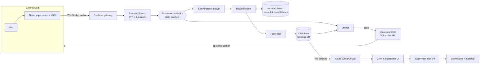

# CrewBrief

> Real-time voice AI that listens to utility crew pre-job briefings and auto-fills hazard and mitigation forms (JSA / SWMS). Built on Azure.

CrewBrief turns a crew's spoken pre-job briefing into a completed hazard assessment. It transcribes the conversation in real time, works out who said what, ignores background noise and off-topic chatter, maps what it hears to the company's hazard and control library, and asks the crew about anything that's missing. A supervisor reviews and signs off. The form is never submitted without a human.

---

## Contents

- [Why](#why)
- [How it works](#how-it-works)
- [Architecture](#architecture)
- [Components](#components)
- [Repository structure](#repository-structure)
- [Getting started](#getting-started)
- [Configuration](#configuration)
- [Accuracy and evaluation](#accuracy-and-evaluation)
- [Privacy and security](#privacy-and-security)
- [Scaling](#scaling)
- [Roadmap](#roadmap)
- [Contributing](#contributing)

---

## Why

Field crews in energy utilities complete a hazard assessment before every job. Filling it in by hand takes around **40 minutes**. That time comes out of productive work, and the quality of the form depends on who's holding the pen.

Crews already talk through the hazards in their pre-job briefing (also called a tailboard or Take 5). CrewBrief captures that conversation and drafts the form from it. The crew's job shrinks from writing the form to reviewing it.

**Goals**

| Goal | Target |
|---|---|
| Time to complete a form | 40 min → under 5 min of review |
| Live form updates during the briefing | ~2 s from speech to on-screen field |
| Spoken follow-up questions | Sub-second response, conversational |
| Concurrent crews | 1,000+ |
| Critical hazard recall | ≥ 98% on the gold evaluation set |

## How it works

1. **The crew briefs as normal.** One device (phone, tablet or in-truck unit) streams audio. Crew members tap in on the app, so the form knows who's present.
2. **Speech is cleaned and transcribed.** The device suppresses noise and detects speech before streaming. Azure AI Speech transcribes it with speaker diarization.
3. **The form fills in live.** The conversation analyst pulls out tasks, site conditions and hazards, each linked to the transcript lines that support it. The hazard expert grounds them in company safety documents. The form filler writes structured updates to the draft.
4. **Gaps are raised during the briefing.** The verifier checks for unsupported fields and for critical hazards with no control. The voice prompter asks the crew, e.g. *"I heard work near live LV, but no isolation or earthing control. What's the plan?"*
5. **A supervisor signs off.** They review the draft, with evidence and confidence shown for each field, then edit and submit. Their edits are logged as an ongoing accuracy signal.

## Architecture

The orchestrator is a **deterministic state machine, not an LLM**. It decides when each specialist role runs, which keeps the real-time path fast and makes every decision auditable. LLMs do only the narrow jobs that need language understanding.



**Session states**

```
CREATED → BRIEFING → DRAFTING ⇄ GAP_CHECK → REVIEW → SIGNED → SUBMITTED
                                                 ↘ ABANDONED
```

## Components

| Component | Type | Responsibility |
|---|---|---|
| **Mobile app** | Client | Crew sign-in, audio capture, on-device noise suppression and VAD, live form view, offline buffering |
| **Realtime gateway** | Service | Authenticates devices and terminates WebSockets. Routes audio to the Speech service and form patches back to clients. |
| **Transcription service** | Service | Azure AI Speech `ConversationTranscriber`, phrase lists and Custom Speech for utility terminology, filtering of low-confidence segments |
| **Session orchestrator** | Deterministic code | Per-session state machine. Schedules roles, enforces rules, holds the session timeline. |
| **Conversation analyst** | LLM role | Transcript window → structured observations (task, site conditions, hazards mentioned, speaker, evidence span). Drops off-topic and non-crew speech. |
| **Hazard expert** | LLM role + RAG | Maps each hazard to the company library. Retrieves approved controls and adds hazards typical for the task type. |
| **Form filler** | LLM role | Produces JSON patches against the form schema, each with evidence and confidence |
| **Verifier** | LLM role + rules | Independently checks the draft: is every field backed by evidence, does every critical hazard have a control, are there contradictions? Outputs a gap list. |
| **Voice prompter** | Voice Live API | Turns gaps into short spoken questions and returns the answers to the analyst |
| **Form API** | Service | Draft storage, review, sign-off, submission to the downstream safety system, audit log |
| **Eval harness** | Offline tooling | Gold dataset, per-role metrics, regression gate in CI |

**Rules that stay in code, not prompts**
- Form schema validation
- A high-risk hazard requires at least one isolation or engineering control
- Hazard and control code mapping
- Sign-off permissions
- A hazard is never marked "not present" just because nobody mentioned it

## Repository structure

```
crewbrief/
├── apps/
│   ├── mobile/                 # Crew app (React Native / Expo; also runs in the browser)
│   └── review-portal/          # Supervisor review web app (React + Vite)
├── services/
│   ├── gateway/                # WebSockets for devices and live UI (FastAPI) + tools/replay.py
│   ├── transcription/          # Azure AI Speech integration, confidence filters, PII redaction
│   ├── orchestrator/           # Session state machine and extraction pipeline
│   ├── roles/
│   │   ├── conversation_analyst/
│   │   ├── hazard_expert/
│   │   ├── form_filler/
│   │   ├── verifier/
│   │   └── voice_prompter/
│   └── form_api/               # Drafts, sign-off, submission, audit, metrics
├── packages/
│   ├── schemas/                # Form schema, patch contracts (Pydantic → JSON Schema)
│   ├── rules/                  # Safety rules enforced in code
│   ├── common/                 # Config, auth, logging, errors, events, HTTP client
│   └── prompts/                # Versioned prompts per role
├── knowledge/
│   ├── sources/                # Hazard & control library (YAML) and safety documents
│   ├── ingest/                 # Ingest the library & docs into a local index or AI Search
│   └── search.py               # Local BM25 / Azure AI Search retrieval
├── eval/
│   ├── datasets/sample_v1/     # Synthetic briefings + gold forms (real gold data is not committed)
│   ├── metrics/                # WER, DER, hazard recall/precision, evidence coverage
│   ├── thresholds.yaml         # CI gate
│   └── run_eval.py
├── samples/                    # Scripted briefings for the replay tool
├── infra/bicep/                # Azure infrastructure as code
├── azure.yaml                  # azd configuration (azd requires it at the repo root)
├── docs/
│   ├── api/contracts.md        # Service contracts
│   ├── architecture.md
│   ├── adr/                    # Architecture decision records
│   └── runbooks/
├── scripts/                    # dev.sh, check_env.py, container health check
├── .github/                    # CI (lint, eval gate, builds, Bicep, secret scan) and deploy
├── Dockerfile                  # One image for all Python services
├── docker-compose.yml
├── Makefile
└── README.md
```

## Getting started

### Prerequisites

- Python 3.12+, Node 20+
- Docker (optional, for `docker compose`)
- Azure CLI and Azure Developer CLI (`azd`), only to deploy to Azure

### Run locally (no Azure needed)

The committed `.env` holds **dummy** values and `CREWBRIEF_MODE=local`, so every Azure dependency is
replaced by an offline stand-in: rule-based roles instead of Azure OpenAI, a local search index instead
of AI Search, SQLite instead of Cosmos DB, and in-process fan-out instead of Web PubSub. Put real keys in
`.env.local` (git-ignored), which overrides `.env`.

```bash
make setup        # Python venv + deps, npm install for both apps
make ingest       # build the local hazard search index
make dev          # gateway :8000, form-api :8001, orchestrator :8002, roles :8003, portal :3000
```

or, with Docker:

```bash
docker compose up --build
```

Open the review portal at `http://localhost:3000`, sign in as **Alex Morgan (supervisor)**, create a
session and use the **briefing simulator** on the session page to speak (browser speech recognition)
or type lines as a crew member. The crew app runs in the browser with `cd apps/mobile && npm run web`.

`make check-env` shows which integrations are local, dummy or real (it never prints secret values).

### Try it with a recorded briefing

```bash
make replay       # python -m services.gateway.tools.replay --script samples/briefing_01.json
```

The draft form, gaps and voice prompts stream to the console and to the review portal live.
`--audio file.wav` streams real audio instead (needs Azure AI Speech).

### Use real Azure services

```bash
azd auth login
azd env new crewbrief-dev
azd env set AZURE_LOCATION australiaeast
azd provision                         # see docs/runbooks/deploy.md
azd env get-values > .env.local       # then set CREWBRIEF_MODE=azure in .env.local
python -m knowledge.ingest --source ./knowledge/sources --index hazards --target azure
```

Individual integrations can be switched on their own, e.g. `LLM_PROVIDER=azure` keeps everything local
except Azure OpenAI. If an LLM call fails, the role falls back to its rule-based version
(`LLM_FALLBACK_TO_HEURISTIC=true`) and the audit log records the fallback.

## Configuration

All settings are in `.env.example` (typed in `packages/common/config.py`). The most important:

| Variable | Description |
|---|---|
| `CREWBRIEF_MODE` | `local` (offline stand-ins, default) or `azure` |
| `STT_PROVIDER`, `LLM_PROVIDER`, `SEARCH_PROVIDER`, `STORE_PROVIDER`, `PUBSUB_PROVIDER`, `VOICE_PROVIDER`, `PII_PROVIDER` | Per-integration override of the mode |
| `AZURE_SPEECH_ENDPOINT` | Azure AI Speech resource endpoint |
| `AZURE_SPEECH_REGION` | e.g. `australiaeast` |
| `AZURE_OPENAI_ENDPOINT` | Foundry / Azure OpenAI endpoint |
| `EXTRACTOR_DEPLOYMENT` | Model deployment for analyst and form filler |
| `VERIFIER_DEPLOYMENT` | Model deployment for the verifier (can differ from the extractor) |
| `VOICE_LIVE_ENDPOINT` | Voice Live API endpoint |
| `SEARCH_ENDPOINT` / `SEARCH_INDEX` | Azure AI Search for the hazard library |
| `COSMOS_ENDPOINT` | Draft and session state |
| `WEBPUBSUB_ENDPOINT` | Live updates to clients |
| `AUTH_MODE` | `dev` (local tokens for seeded users) or `entra` |
| `EXTRACTION_INTERVAL_SECONDS` | How often the analyst runs (default `8`) |
| `RETAIN_RAW_AUDIO` | `false` by default; transcripts only |
| `PII_REDACTION` | `true` by default |

Authentication uses managed identity (`DefaultAzureCredential`). Don't put keys in `.env` for anything
beyond local development; values containing `dummy` are treated as unset.

## Accuracy and evaluation

A form that looks complete but is wrong is worse than no form. Accuracy is measured at three levels.

**1. Offline, against a gold dataset.** Recorded or scripted briefings with realistic site noise, each paired with a form completed by safety SMEs.

| Layer | Metric |
|---|---|
| Transcription | Word error rate, overall and on domain terms (LV/HV, EWP, earthing, isolation) |
| Diarization | Diarization error rate |
| Conversation analyst | Hazard recall and precision, **weighted by severity** |
| Hazard expert | Correct control retrieved per hazard; correct code mapping |
| Form filler | Field-level exact / semantic match |
| Whole form | **Evidence coverage**: every filled field cites a transcript span. Hallucination rate = fields with no supporting evidence |
| Verifier | Share of seeded gaps caught |

Recall matters more than precision. A missed hazard costs far more than an extra one.

```bash
python eval/run_eval.py --dataset eval/datasets/sample_v1 --report eval/reports/ --fail-under   # or: make eval
```

CI fails a pull request if critical hazard recall, evidence coverage, hallucination rate or the seeded-gap catch rate crosses the thresholds in `eval/thresholds.yaml`. The committed `sample_v1` set is synthetic; real SME gold data (`eval/datasets/gold_*`) is kept out of git.

**2. Shadow pilot.** Crews fill in forms manually as today while CrewBrief drafts in parallel. The two are compared before the agent is shown to anyone.

**3. Production.** Every supervisor edit is logged as a diff between the AI draft and the signed form. Edit rate per field and per role is the ongoing accuracy dashboard.

## Privacy and security

- **Data residency:** all processing in Australia East
- **Network:** private endpoints, VNet integration, no public data-plane access
- **Identity:** Entra ID for users, managed identity for services
- **Encryption:** customer-managed keys for storage and Cosmos DB
- **Minimal retention:** raw audio is not stored by default. Transcripts have PII redacted (Azure AI Language) and are kept only as long as the retention policy allows.
- **No voice biometrics:** speakers are linked to crew members through app sign-in and context, not voice prints
- **Consent:** crews are notified when recording is active, and recording can be paused at any time. Deployment requires legal review under workplace surveillance and listening-device laws in each state.
- **Audit:** every field records its source evidence, the model and prompt version, and the reviewer's action

## Scaling

- Each active briefing is one long-lived streaming session. Gateway and orchestrator workers are stateless and autoscale on Azure Container Apps with KEDA, or on AKS.
- LLM roles use **provisioned throughput (PTU)** for predictable latency during morning peaks.
- Several Speech resources sit behind a router to stay within concurrency quotas.
- Only the analyst and form filler run on the hot path. The verifier runs at milestones, which keeps LLM calls at roughly 100 per second at 1,000 concurrent sessions.
- **Offline mode:** in poor coverage, the device buffers audio and processes the session when connectivity returns.

## Roadmap

- [x] Phase 0: form schema, hazard library ingestion, offline prototype scored end to end (6 synthetic briefings; 20 SME gold briefings still to collect)
- [x] Phase 1: real-time pipeline for a single crew with live form updates
- [x] Phase 2: verifier and spoken gap prompts
- [ ] Phase 3: shadow pilot with 10 crews
- [ ] Phase 4: scale-out, PTU, multi-region Speech, offline mode
- [ ] Later: work-order and switching-instruction context, weather and fire-danger inputs

## Contributing

1. Create a branch from `main` named `<type>/<short-description>` (e.g. `feature/match-history-page`).
2. Any change to prompts, schemas or model deployments must include an eval run (`eval/run_eval.py`) and its report in the pull request.
3. Record significant design decisions as an ADR in `docs/adr/`.

See `CONTRIBUTING.md` and `SECURITY.md`.

---

*CrewBrief assists with hazard assessment. It does not replace the crew's or supervisor's responsibility for job safety.*
