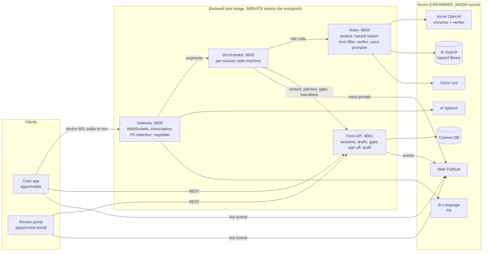
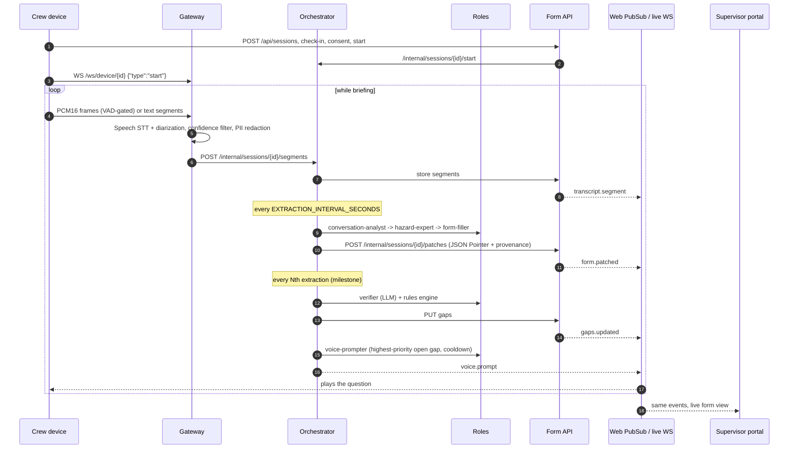
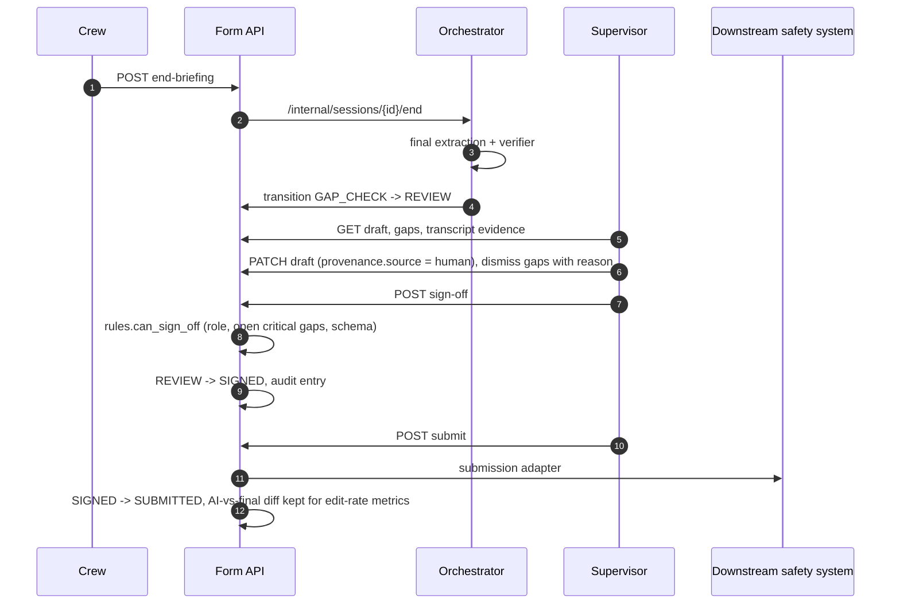

# Architecture

This page describes how CrewBrief is put together: the components, how one briefing flows
through them, how sign-off works, and how the same code runs offline on a laptop and on Azure.
Service contracts are in [`docs/api/contracts.md`](api/contracts.md). Decisions behind the design
are recorded as ADRs in [`docs/adr/`](adr/).

## Components

| Component | Owns | Does not own |
|---|---|---|
| Gateway | Device and live WebSockets, speech-to-text, PII redaction of every segment, Web PubSub negotiate | Session state, persistence |
| Orchestrator | When each role runs, extraction cadence, verifier milestones, voice-prompt cooldown, state transitions it drives | Storage (calls the form API), language understanding |
| Roles | The narrow LLM jobs, each with a deterministic heuristic fallback | Scheduling, persistence, rules |
| Form API | Sessions, drafts and revisions, transcript, gaps, sign-off, submission, audit log, event publishing after each commit | Deciding what to extract |
| `packages/rules` | Safety rules in code: schema validation, critical-hazard controls, code mapping, sign-off permissions | |

## Live loop (one briefing)

The analyst and form filler are the only roles on the hot path. The verifier runs at
milestones and at the end of the briefing, which keeps LLM traffic bounded as sessions grow.

## Review and sign-off

Session states: `CREATED → BRIEFING → DRAFTING ⇄ GAP_CHECK → REVIEW → SIGNED → SUBMITTED`,
with `ABANDONED` reachable before sign-off. The form is never submitted without a supervisor.

## Modes: local and Azure

Every integration sits behind a small Protocol with a local and an Azure implementation
(ADR 0002). `CREWBRIEF_MODE` picks the default; `*_PROVIDER` overrides one integration.

| Integration | `local` | `azure` |
|---|---|---|
| Speech-to-text | Not available; devices send text segments | Azure AI Speech `ConversationTranscriber` |
| LLM roles | Deterministic heuristics | Azure OpenAI deployments `extractor`, `verifier` |
| Hazard search | Local index of `knowledge/sources` | Azure AI Search (semantic) |
| Store | SQLite in `./var` | Cosmos DB, one container per collection, `/session_id` partition |
| Live updates | Gateway `/ws/live` fan-out | Azure Web PubSub group `session.<id>` |
| Voice prompts | Text, spoken by the device's TTS | Voice Live API |
| PII redaction | Local stand-in | Azure AI Language |
| Auth | Dev HS256 tokens for seeded users | Entra ID |

`python scripts/check_env.py` prints the resolved provider per integration without showing secrets.

## Ports

| Service | Local port | Azure ingress |
|---|---|---|
| gateway | 8000 | external (devices, negotiate) |
| form-api | 8001 | external (`/api`); `/internal` requires the internal token |
| orchestrator | 8002 | internal only |
| roles | 8003 | internal only |
| review-portal | 3000 (container listens on 8080) | external |
| mobile (Expo web) | 8081 | n/a |

## Azure deployment

`infra/bicep/main.bicep` provisions one resource group in Australia East:

- **Compute**: a VNet-integrated Container Apps environment with five apps and a manual ingest
  job. KEDA HTTP rules scale each app; the gateway scales on concurrent WebSocket connections.
- **Identity**: one user-assigned managed identity per workload, each with only the roles it
  needs. Key/local auth is disabled on Speech, OpenAI, Language, Search, Cosmos DB and Web PubSub.
- **Network**: data planes are reached through private endpoints and private DNS zones. Web PubSub
  keeps its public endpoint for client connections only; REST and server connections are private.
- **Secrets**: Key Vault (RBAC, purge protection). The only application secret is the internal
  service token, referenced by the container apps rather than copied into app settings.
- **Observability**: Log Analytics + Application Insights (OpenTelemetry). Every resource sends
  diagnostics to the workspace.

See [`runbooks/deploy.md`](runbooks/deploy.md) for provisioning and
[`runbooks/scaling-morning-peak.md`](runbooks/scaling-morning-peak.md) for capacity.
